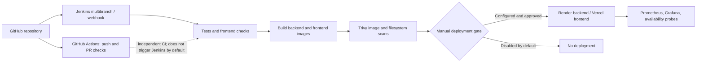

# Autonomous FinOps Guardian — DevOps Guide

This repository adds build, validation, security, local orchestration, monitoring, and optional Kubernetes configurations around the existing React/Vite and FastAPI application. The application UI, routes, API response formats, FinOps calculations, ML/AI agents, and approval/remediation behavior were left unchanged.

## Architecture and status



GitHub Actions and Jenkins each watch GitHub independently. Configure a GitHub webhook or Multibranch Pipeline scan to trigger Jenkins; the GitHub Actions workflow does not dispatch Jenkins automatically. Render and Vercel remain the intended hosted services. Docker Compose and Kubernetes are local/self-managed options, not claims of a cloud deployment.

| Feature | Status |
|---|---|
| Backend and frontend Dockerfiles, Nginx API proxy and Compose | Implemented; verify using the commands below |
| GitHub Actions CI and dependency/repository security workflow | Implemented; runs when pushed to GitHub |
| Jenkins declarative pipeline | Implemented; requires a Jenkins agent with Python, Node, Docker and Trivy |
| Credential-free backend health test | Implemented; existing credentialed AWS/Gemini scripts are excluded from CI |
| Kubernetes manifests | Implemented for a local cluster; no cluster deployment is implied |
| Prometheus, Grafana and Blackbox availability monitoring | Windows-compatible Compose `monitoring` profile |
| cAdvisor Docker container metrics | Opt-in `docker-metrics` profile; reads Docker Desktop Linux VM container/cgroup data through the daemon socket |
| Node Exporter | Linux-host-only `linux-host` profile; not enabled or scraped in the Windows default profile |
| Render/Vercel production rollout | Existing hosting architecture retained; deployment requires configured provider integration and explicit approval |

## Docker and Docker Compose

Install Docker Desktop on Windows (or Docker Engine plus Compose v2 on Linux). From the repository root in PowerShell:

```powershell
docker --version
docker compose version
docker compose config
docker compose up --build -d
docker compose ps
Invoke-RestMethod http://localhost:8000/health
Invoke-WebRequest http://localhost:8080/ -UseBasicParsing
Invoke-WebRequest http://localhost:8080/api/health -UseBasicParsing
```

The backend listens on host port 8000 and the Nginx frontend on 8080 by default. Override with `BACKEND_PORT` and `FRONTEND_PORT`. The frontend serves the Vite build, falls back to `index.html` for client-side routes, and proxies `/api/*` to FastAPI. The backend image is Python 3.11 and runs as UID/GID 10001. The frontend uses a Node 22 build stage and an unprivileged Nginx image. No private Vite variables are passed at build time; `VITE_API_BASE_URL=/api` is a public path.

Configuration defaults to `EXECUTION_MODE=simulation` and `ALLOW_AWS_SCAN=false`. For Compose interpolation, create a local root `.env` from `.env.example` and set only non-production values you need. Learner Lab uses `AWS_ACCESS_KEY_ID`, `AWS_SECRET_ACCESS_KEY`, `AWS_SESSION_TOKEN`, and `AWS_REGION`; regular access keys can omit the session token. Compose passes AWS environment variables only to the backend and mounts the project-root `.env` read-only. Keep actual credentials in ignored local `.env`, never in source, image layers, workflow variables, or logs. AWS scans remain disabled until `ALLOW_AWS_SCAN` is explicitly enabled. Gemini is optional. No production credentials are needed to build or run the local app.

```powershell
docker compose logs --tail 100 backend frontend
docker compose down
```

Compose named volumes retain Prometheus and Grafana data. `docker compose down -v` deletes those monitoring volumes.

## Jenkins setup and pipeline

Install a supported Jenkins LTS and Docker on a Linux agent. Install Pipeline, Git, Credentials Binding and JUnit plugins. The agent needs Python 3.11, Node/npm 22, Docker CLI with daemon access, and Trivy on `PATH`. Configure a Multibranch Pipeline pointed at this GitHub repository and use the root `Jenkinsfile`; configure a GitHub webhook or periodic branch scan for triggers. Do not grant production credentials to general PR jobs.

The declarative stages check tools and safety defaults, install existing dependencies, run `python -m unittest discover -s tests -v`, run the existing `npm run lint` and `npm run build`, build and inspect both images, and fail on Trivy HIGH/CRITICAL findings. Builds have a 60-minute timeout and Docker images are removed after the job. Frontend build artifacts are archived. The repository's top-level `test_aws.py`, `test_gemini.py`, and `test_gemini_models.py` are manual credentialed integration scripts, not unit tests; the pipeline does not call AWS or Gemini.

Deployment is skipped unless all of these are configured: pipeline parameter `ENABLE_DEPLOYMENT=true`, a non-empty `DEPLOY_TARGET`, and Jenkins job environment variable `DEPLOY_COMMAND`. Jenkins then pauses at a manual `input` gate. If needed, configure `DEPLOY_CREDENTIALS_ID` as a Jenkins Secret Text credential; it is exposed only as `DEPLOY_TOKEN` inside the deployment step and shell tracing is disabled. The configured command must perform deployment and a post-deployment health check. Leave the parameter off for ordinary builds. No provider token or deployment target is invented by this repository.

## GitHub Actions

`.github/workflows/ci.yml` runs on pushes to `main` and pull requests targeting `main`, with read-only repository permissions. It caches pip/npm, runs backend unittest discovery, the existing ESLint and Vite build scripts, Docker builds without publishing images, YAML/JSON syntax validation, and Docker Compose model validation (including the optional cAdvisor overlay). `.github/workflows/security.yml` audits Python dependencies with `pip-audit`, npm dependencies with `npm audit`, and scans the repository with Trivy for vulnerabilities, misconfiguration, and secrets at HIGH/CRITICAL severity. It also runs weekly and by manual dispatch. Neither workflow needs production secrets or executes live scans/remediation.

## Kubernetes (optional local deployment)

Kubernetes is optional. These manifests target a local Docker Desktop Kubernetes cluster. They keep simulation mode enabled and live AWS scanning disabled. AWS credentials are not required for a synthetic scan. Do not enable live scanning as part of this setup.

### Build the images

In PowerShell from the repository root, using Docker Desktop's Linux engine:

```powershell
docker context use desktop-linux
docker build -f backend/Dockerfile -t autonomous-finops-backend:local .
docker build -f frontend/Dockerfile -t autonomous-finops-frontend:local .
docker image inspect autonomous-finops-backend:local
docker image inspect autonomous-finops-frontend:local
```

The Kubernetes Deployments reference those exact names with `imagePullPolicy: IfNotPresent`. Docker Desktop Kubernetes supports its local image store; choose a provisioning mode compatible with the Docker Desktop image store in use. Do not retag or publish images unless using a separate cluster/registry.

### Prepare a local Kubernetes Secret

The backend accepts AWS credentials from environment variables when `/app/.env` is absent, as it is in Kubernetes. The Secret is only referenced by the backend Deployment; the frontend has no Secret reference. For optional, read-only AWS discovery at a later, deliberate time, make a local credentials file containing only the required keys:

```powershell
kubectl apply -f k8s/namespace.yaml
Copy-Item k8s/secret.env.example k8s/secret.env
notepad k8s/secret.env
```

Enter values locally for `AWS_ACCESS_KEY_ID`, `AWS_SECRET_ACCESS_KEY`, and (for Learner Lab temporary credentials) `AWS_SESSION_TOKEN`. `AWS_REGION` is supplied by the ConfigMap. The file `k8s/secret.env` is ignored by Git. Create/update the cluster Secret without displaying its data:

```powershell
kubectl create secret generic finops-secrets --namespace finops --from-env-file=k8s/secret.env --dry-run=client -o yaml | kubectl apply -f -
```

For synthetic-only use, skip Secret creation; the Deployment marks the Secret reference optional. Kubernetes Secret values are not a substitute for an external secret manager or encrypted-at-rest cluster storage. Do not run `kubectl get secret -o yaml` or commit generated Secret YAML.

### Validate, apply and access

First verify Docker Desktop Kubernetes is already enabled and the selected context is correct. These commands inspect state only:

```powershell
kubectl config current-context
kubectl get nodes
```

Validate manifests locally without applying them:

```powershell
kubectl apply --dry-run=client -f k8s/namespace.yaml
kubectl apply --dry-run=client -f k8s/configmap.yaml
kubectl apply --dry-run=client -f k8s/backend-service.yaml -f k8s/backend-deployment.yaml
kubectl apply --dry-run=client -f k8s/frontend-service.yaml -f k8s/frontend-deployment.yaml
```

Only after review, apply the workload (the example Secret manifest has blank values and should not be applied):

```powershell
kubectl apply -f k8s/configmap.yaml
kubectl apply -f k8s/backend-service.yaml -f k8s/backend-deployment.yaml
kubectl apply -f k8s/frontend-service.yaml -f k8s/frontend-deployment.yaml
kubectl rollout status deployment/backend -n finops
kubectl rollout status deployment/frontend -n finops
kubectl get pods,services -n finops
```

Use port-forwarding for initial local access; no Ingress controller is required:

```powershell
kubectl port-forward -n finops svc/frontend 8080:80
```

Then open `http://localhost:8080`. In another terminal, verify the backend health endpoint with `kubectl port-forward -n finops svc/backend 8000:8000`, then `Invoke-RestMethod http://localhost:8000/health`. The existing `k8s/ingress.yaml` is optional and intentionally omitted from these steps; do not apply it until a maintained Ingress/Gateway implementation is selected and configured.

The existing Deployments retain non-root security contexts, CPU/memory requests and limits, and HTTP probes. Application outputs are written across `synthetic_data/`, `ml/`, `agents/*/results` and `workflow/results`/`workflow/history`. These paths currently live inside the container filesystem, so scan outputs and approval history are ephemeral across pod replacement. A PVC should wait until the application has a deliberate persistent data-root layout; mounting one volume over `/app` would mask the image code and bundled inputs. No database or storage infrastructure is added here.

## Prometheus and Grafana

On Windows 11 with Docker Desktop Linux containers, start only the monitoring services; this leaves running backend and frontend containers untouched:

```powershell
docker compose --profile monitoring up -d prometheus grafana blackbox
Invoke-WebRequest http://localhost:9090/-/ready -UseBasicParsing
Invoke-WebRequest http://localhost:3000/api/health -UseBasicParsing
Invoke-WebRequest http://localhost:9090/api/v1/targets -UseBasicParsing
```

The default Prometheus config scrapes itself and Blackbox HTTP probes for backend `/health` and frontend `/`. Prometheus targets are also visible at `http://localhost:9090/targets`. Grafana is at `http://localhost:3000`; set `GRAFANA_ADMIN_PASSWORD` in the local environment before startup and do not print or commit it. Prometheus and Grafana data persist in named volumes. The provisioned dashboard is **Autonomous FinOps Guardian — Containers**. Its availability panel works in the default Windows profile. Container CPU and memory panels need the optional cAdvisor profile.

### Optional cAdvisor metrics on Docker Desktop

cAdvisor runs inside Docker Desktop's Linux VM and may report Linux container metrics, not Windows hardware. Availability of full metrics depends on Docker Desktop's socket and cgroup access. The optional config avoids privileged mode, `/dev/kmsg`, full host-root mounts, Docker data-directory mounts, and mount propagation. It mounts the Docker daemon socket at `/var/run/docker.sock` plus the cgroup tree. **The socket is highly sensitive:** a read-only bind mount does not restrict Docker API operations. Enable this only if granting that access is acceptable.

To try it, apply the overlay so Prometheus includes the cAdvisor target, and explicitly enable the profile:

```powershell
docker compose --profile monitoring --profile docker-metrics -f docker-compose.yml -f docker-compose.docker-metrics.yml up -d prometheus grafana blackbox cadvisor
docker compose ps prometheus grafana blackbox cadvisor
Invoke-WebRequest http://localhost:9090/-/ready -UseBasicParsing
Invoke-RestMethod http://localhost:9090/api/v1/targets
```

If cAdvisor cannot read the Docker socket or cgroups in the current Docker Desktop backend, turn that profile off with `docker compose --profile monitoring up -d prometheus grafana blackbox`; the default Prometheus configuration has no cAdvisor target and does not show an exporter that is intentionally disabled as DOWN. Node Exporter is kept only for a native Linux host under the `linux-host` profile and is not included in the Windows Prometheus targets. It does not report Windows hardware from Docker Desktop's Linux VM. Use Windows-native host telemetry separately if Windows CPU/memory metrics are needed.

## Security scanning

Install Trivy locally to scan built images and repository configuration:

```powershell
trivy fs --scanners vuln,misconfig,secret --severity HIGH,CRITICAL .
docker build -f backend/Dockerfile -t autonomous-finops-backend:local .
docker build -f frontend/Dockerfile -t autonomous-finops-frontend:local .
trivy image --severity HIGH,CRITICAL autonomous-finops-backend:local
trivy image --severity HIGH,CRITICAL autonomous-finops-frontend:local
python -m pip install pip-audit
pip-audit -r requirements.txt
Push-Location frontend
npm audit --audit-level=high
Pop-Location
```

CI and Jenkins fail on HIGH/CRITICAL findings. The frontend lockfile was updated within the current semver ranges to clear its high findings. The verified npm audit currently reports three MODERATE findings through `minimatch`, a transitive dependency of the development-only TypeScript ESLint parser; npm's only offered forced fix downgrades that parser to 6.x. This is accepted at the configured HIGH/CRITICAL threshold and should be revisited when a compatible upstream parser release resolves it. No HIGH/CRITICAL issues are suppressed. If a scanner reports one, update the relevant dependency/base image and rerun; document any future exception with package, advisory, rationale and expiry before adding an ignore. `.dockerignore` excludes `.env`, local AWS configuration, keys and caches; container users are non-root. Keep credentials in provider/Jenkins secret stores or local environment variables, never images, source, build arguments, or logs.

## Deployment, environment variables and rollback

The existing `render.yaml` remains the Render backend blueprint and retains simulation mode, disabled AWS scans, Python 3.11 and `/health`. Set `CORS_ALLOW_ORIGINS` and optional `GEMINI_API_KEY` in the Render dashboard as appropriate. For Vercel, keep using the existing `frontend/vercel.json`; set `VITE_API_BASE_URL` to the Render API base URL (without a trailing slash) in the Vercel project settings, and use preview-specific backend/CORS settings for preview deployments. Vite variables are public and must not contain secrets. Verify the Render `/health` URL and the Vercel preview URL before promoting a release. Review the existing Vercel configuration before changing its routing.

Recommended release sequence: review changes and CI on a PR; merge through the repository's normal review policy; verify the Render build and health endpoint; deploy a Vercel preview and test frontend-to-backend requests; promote to production only after the gate and health checks. This repository does not trigger or claim an external production deployment. Configure provider GitHub integrations or the gated Jenkins deployment command explicitly.

For rollback, use Render's previous successful deploy in its dashboard, then redeploy the previous Vercel deployment. If using Jenkins, rerun the previously verified commit/image and run the configured health check. For local Compose, `docker compose down` then check out/build the prior known-good commit (preserve local changes first). Kubernetes rollback: `kubectl rollout undo deployment/backend -n finops` and/or `kubectl rollout undo deployment/frontend -n finops`; confirm with `kubectl rollout status`.

## Troubleshooting

- **Compose reports port in use:** set `BACKEND_PORT=8001` and/or `FRONTEND_PORT=8081` in `.env`, then retry.
- **Backend is unhealthy:** run `docker compose logs backend`; verify dependencies installed and `EXECUTION_MODE=simulation`. `/health` does not require AWS credentials.
- **Frontend loads but API fails:** check `docker compose ps`, `docker compose logs backend frontend`, and `http://localhost:8080/api/health`; make sure frontend was built with `/api` and Nginx can resolve `backend` on the Compose network.
- **Jenkins cannot find Docker/Trivy:** install them on the agent and ensure the Jenkins service account can access the Docker daemon; do not expose a privileged daemon to untrusted builds.
- **CI dependency audit fails:** inspect the advisory and update lock/dependency pins; do not suppress scan output.
- **Minikube pods cannot pull images:** confirm the image was built after selecting Minikube's Docker environment and `imagePullPolicy` remains `IfNotPresent`.
- **Prometheus target is down:** check `docker compose --profile monitoring ps`, inspect Prometheus `/targets`, and view `docker compose logs prometheus blackbox cadvisor`.
