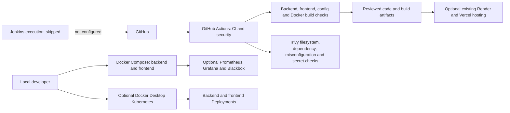

# Autonomous FinOps Guardian — DevOps Guide

This guide describes the DevOps configuration present in this repository. It covers local Docker Compose, optional Docker Desktop Kubernetes, GitHub Actions, Trivy, Prometheus/Grafana, and the AWS read-only discovery integration. The React/Vite UI, FastAPI endpoints, FinOps calculations, ML/AI agents, and approval workflow remain application-owned behavior.

## Architecture and implementation status



GitHub Actions validates changes; it does not publish images, deploy to production, enable AWS scans, or run remediation. Render remains the configured backend hosting target and Vercel the frontend target; deployments require the existing provider integration and are not performed by these workflows. Kubernetes is an optional local deployment. Jenkins was skipped: although a `Jenkinsfile` exists in the repository, no Jenkins server/agent was configured or used for this implementation.

| Component | Repository configuration and status |
|---|---|
| Backend container | Python 3.11 image, Uvicorn, health check, UID/GID 10001 |
| Frontend container | Node 22 build stage, Nginx unprivileged runtime, port 8080, SPA fallback and `/api` proxy |
| Compose | Backend, frontend and optional monitoring profiles; application defaults to simulation |
| Kubernetes | Namespace, ConfigMap, optional Secret reference, Services, Deployments and optional Ingress manifests |
| Kubernetes hardening | Pod/container non-root identities, read-only root filesystems, dropped capabilities, no privilege escalation, RuntimeDefault seccomp and scoped writable volumes |
| GitHub Actions | CI and security workflows on pushes to `main` and pull requests targeting `main`; security also supports weekly and manual runs |
| Trivy | Repository filesystem scan for vulnerabilities, misconfiguration and secrets at HIGH/CRITICAL severity; failures are not suppressed |
| Monitoring | Prometheus, Grafana and Blackbox in the Windows-compatible `monitoring` Compose profile; cAdvisor and Node Exporter are optional profiles |
| Jenkins | Skipped; no Jenkins run or deployment is claimed |

The Kubernetes hardening manifests passed YAML validation and the Trivy scan. The hardened backend and frontend Deployments were successfully rolled out: both Pods reached `1/1 Running` with zero restarts, and application access was tested successfully. CI also passed backend tests, frontend lint/build, configuration checks, and both Docker image builds for the hardening commit.

## Docker and Docker Compose

Install Docker Desktop (Linux containers) or Docker Engine with Compose v2. From the repository root in PowerShell:

```powershell
docker --version
docker compose version
docker compose config --quiet
docker compose up --build -d
docker compose ps
Invoke-RestMethod http://localhost:8000/health
Invoke-WebRequest http://localhost:8080/ -UseBasicParsing
Invoke-WebRequest http://localhost:8080/api/health -UseBasicParsing
```

The backend is exposed on host port 8000 and the frontend on 8080 by default. `BACKEND_PORT` and `FRONTEND_PORT` can override these ports. Nginx serves the Vite build, falls back to `index.html` for client-side routes, and proxies `/api/` to the backend service. The frontend build receives only the public API path (`VITE_API_BASE_URL=/api`); AWS credentials are never sent to the frontend.

Compose defaults are `EXECUTION_MODE=simulation` and `ALLOW_AWS_SCAN=false`. The backend receives AWS variables through Compose and mounts the project-root `.env` at `/app/.env` read-only. `backend/utils/aws_client.py` loads this project-root file and also accepts environment-injected values, including Kubernetes Secret variables. Learner Lab uses `AWS_ACCESS_KEY_ID`, `AWS_SECRET_ACCESS_KEY`, optional `AWS_SESSION_TOKEN`, and `AWS_REGION`; regular access keys work without a session token. Keep actual values in a local ignored `.env` or a secret store. `.env.example` contains names/placeholders only. Credentials must not be committed, baked into images, passed to Vite, or printed in logs.

If `.env` does not exist, create it without overwriting an existing credentials file:

```powershell
if (-not (Test-Path .env)) { Copy-Item .env.example .env }
```

Start, inspect, and stop the application with:

```powershell
docker compose logs --tail 100 backend frontend
docker compose down
```

`docker compose down -v` also deletes named monitoring data volumes; use it only when that data can be discarded.

## GitHub Actions and security checks

`.github/workflows/ci.yml` runs on pushes to `main` and pull requests targeting `main`. It uses GitHub-hosted runners and read-only repository permissions. It installs Python dependencies, runs `python -m unittest discover -s tests -v`, runs the existing frontend `npm ci`, lint and production build, validates YAML/JSON and Docker Compose configuration, and builds both Docker images without publishing them. CI sets `EXECUTION_MODE=simulation`, disables live scans, and disables EC2 metadata access for backend tests.

`.github/workflows/security.yml` runs on pushes to `main`, pull requests targeting `main`, a weekly schedule, and manual dispatch. It runs `pip-audit`, `npm audit --audit-level=high`, and the official `aquasecurity/trivy-action@v0.36.0`. Trivy scans the repository filesystem with vulnerability, misconfiguration, and secret scanners at `HIGH,CRITICAL`; `exit-code: 1` makes findings fail the job. The workflow does not scan/publish built images or deploy them. The security workflow and CI passed on the hardening commit; this result does not replace runtime verification of a Kubernetes rollout. Moderate dependency advisories may be reported below the npm audit threshold; findings are not suppressed.

Local checks, if Trivy is installed:

```powershell
trivy fs --scanners vuln,misconfig,secret --severity HIGH,CRITICAL .
python -m pip install pip-audit
pip-audit -r requirements.txt
Push-Location frontend
npm ci
npm audit --audit-level=high
npm run lint
npm run build
Pop-Location
```

For optional local image scanning, build the images as described below and run `trivy image --severity HIGH,CRITICAL <image-name>`. This is separate from the GitHub workflow’s filesystem scan.

## Kubernetes on Docker Desktop

Kubernetes is optional; normal Compose operation does not require it. The manifests use local image names `autonomous-finops-backend:local` and `autonomous-finops-frontend:local` with `imagePullPolicy: IfNotPresent`.

Build the images using Docker Desktop’s Linux engine:

```powershell
docker context use desktop-linux
docker build -f backend/Dockerfile -t autonomous-finops-backend:local .
docker build -f frontend/Dockerfile -t autonomous-finops-frontend:local .
docker image inspect autonomous-finops-backend:local
docker image inspect autonomous-finops-frontend:local
```

The `finops-config` ConfigMap sets `EXECUTION_MODE=simulation` and `ALLOW_AWS_SCAN=false`. Leave these defaults in place for the initial deployment. The backend optionally references `finops-secrets`; the frontend has no Secret reference. No AWS credentials are required for simulation mode. Never put real values in committed Kubernetes YAML. If a later, deliberate read-only AWS discovery is approved, create the Secret locally from an ignored file and keep it out of Git; do not enable remediation or put AWS variables in the frontend.

Validate the selected cluster and manifests before applying:

```powershell
kubectl config current-context
kubectl get nodes
kubectl apply --dry-run=client -f k8s/namespace.yaml
kubectl apply --dry-run=client -f k8s/configmap.yaml
kubectl apply --dry-run=client -f k8s/backend-service.yaml -f k8s/backend-deployment.yaml
kubectl apply --dry-run=client -f k8s/frontend-service.yaml -f k8s/frontend-deployment.yaml
```

Apply the simulation configuration and workloads:

```powershell
kubectl apply -f k8s/namespace.yaml
kubectl apply -f k8s/configmap.yaml
kubectl apply -f k8s/backend-service.yaml -f k8s/backend-deployment.yaml
kubectl apply -f k8s/frontend-service.yaml -f k8s/frontend-deployment.yaml
kubectl -n finops rollout status deployment/backend --timeout=180s
kubectl -n finops rollout status deployment/frontend --timeout=180s
kubectl -n finops get pods,services
kubectl -n finops get events --sort-by=.lastTimestamp
```

Access the frontend through port-forwarding; no Ingress controller is required:

```powershell
kubectl port-forward -n finops svc/frontend 8080:80
```

Open `http://localhost:8080`. In a second terminal, the backend can be checked with `kubectl port-forward -n finops svc/backend 8000:8000`, then `Invoke-RestMethod http://localhost:8000/health`. The optional Ingress manifest is not needed for this local path.

Both Deployments use non-root pod identities (backend 10001, frontend 101), read-only root filesystems, no privilege escalation, dropped Linux capabilities, RuntimeDefault seccomp, resource requests/limits and HTTP probes. The backend init container seeds an `emptyDir` with existing bundled artifacts, then mounts only the data/output, report, log, figure and temporary paths that need writes. Nginx has scoped `/tmp` and cache mounts for PID/temp/cache writes. `emptyDir` data is ephemeral across Pod replacement; the manifests do not add a PVC or database. The existing application still has outputs distributed across `synthetic_data/`, `ml/`, `agents/` and `workflow/`, so plan a deliberate persistent data layout before requiring durable scan history.

## Prometheus and Grafana monitoring

On Windows 11 with Docker Desktop Linux containers, the default monitoring profile starts Prometheus, Grafana, and Blackbox Exporter. It probes backend `/health` and frontend `/`; it does not claim to collect Windows host hardware metrics.

Start monitoring without rebuilding or restarting the application containers:

```powershell
docker compose --profile monitoring up -d prometheus grafana blackbox
docker compose ps prometheus grafana blackbox
Invoke-WebRequest http://localhost:9090/-/ready -UseBasicParsing
Invoke-WebRequest http://localhost:3000/api/health -UseBasicParsing
Invoke-RestMethod http://localhost:9090/api/v1/targets
```

Prometheus is available at `http://localhost:9090`; its targets are shown at `/targets`. Grafana is available at `http://localhost:3000` and uses the provisioned Prometheus data source and **Autonomous FinOps Guardian — Containers** dashboard. Set a local `GRAFANA_ADMIN_PASSWORD` before startup; do not commit or print it. Prometheus and Grafana retain their data in named Compose volumes.

cAdvisor is an optional `docker-metrics` profile for Docker Desktop’s Linux VM/container metrics. It requires access to the Docker daemon socket, which is highly privileged even when bind-mounted read-only. Enable it only when that access is acceptable:

```powershell
docker compose --profile monitoring --profile docker-metrics -f docker-compose.yml -f docker-compose.docker-metrics.yml up -d prometheus grafana blackbox cadvisor
docker compose ps prometheus grafana blackbox cadvisor
Invoke-RestMethod http://localhost:9090/api/v1/targets
```

Docker Desktop cAdvisor results depend on Docker socket and cgroup access; they do not represent Windows hardware. Node Exporter is only for native Linux host metrics and is optional under the `linux-host` profile; it is not enabled or scraped by the default Windows monitoring configuration. If cAdvisor is unavailable, use the default monitoring profile without its overlay. Do not leave a disabled exporter as a Prometheus target.

## AWS integration and safety

The backend’s shared Boto3 client loads `AWS_ACCESS_KEY_ID`, `AWS_SECRET_ACCESS_KEY`, optional `AWS_SESSION_TOKEN`, and `AWS_REGION`. It supports Learner Lab temporary credentials and permanent-style keys. Compose uses the project-root `.env` as a read-only `/app/.env` mount. Kubernetes injects optional credentials only into the backend through the `finops-secrets` Secret reference; the frontend never receives them. Never add actual credentials to `.env.example`, YAML, GitHub, container images, or logs.

The Kubernetes ConfigMap explicitly keeps `EXECUTION_MODE=simulation` and `ALLOW_AWS_SCAN=false`; Compose defaults are also simulation with live scans disabled. A live scan requires deliberate configuration and read-only AWS IAM permissions; do not enable it as part of deployment validation. Remediation remains in simulation mode with human approval intact. Costs shown from resource metadata are estimates; do not describe them as actual AWS billing data unless Cost Explorer integration is implemented and verified.

## Hosting, rollback and troubleshooting

The repository retains `render.yaml` for the FastAPI backend and `frontend/vercel.json` for Vercel. The GitHub Actions workflows do not deploy to either service. Configure preview and production environment variables in the respective provider dashboards; keep AWS and Gemini secrets out of Vite frontend variables. Verify backend `/health`, frontend availability, and CORS before promoting a provider-managed release.

For a provider deployment, use the provider’s previous successful deployment to roll back. For Kubernetes, `kubectl rollout undo deployment/backend -n finops` or `kubectl rollout undo deployment/frontend -n finops`, then verify with `kubectl rollout status`. For Compose, rebuild/restart from a known-good revision after preserving local changes.

- **Compose port is busy:** set `BACKEND_PORT` or `FRONTEND_PORT` in a local `.env` and rerun `docker compose config --quiet`.
- **Backend health fails:** inspect `docker compose logs backend`; `/health` does not require AWS credentials. Confirm `EXECUTION_MODE=simulation`.
- **Frontend API requests fail:** verify both services are healthy and that the browser requests `/api/` through Nginx.
- **Kubernetes Pod is not ready:** inspect `kubectl -n finops describe pod <pod-name>` and `kubectl -n finops logs <pod-name> -c <container-name>`; check that the matching local image exists and `emptyDir` mounts are writable by the configured UID/GID.
- **Prometheus probe is down:** inspect `/targets`, Blackbox logs, and the Compose service names/ports.
- **Security audit fails:** inspect the reported advisory or misconfiguration and update the affected dependency/configuration. Do not lower severity, suppress findings, or commit secrets to make a check pass.
